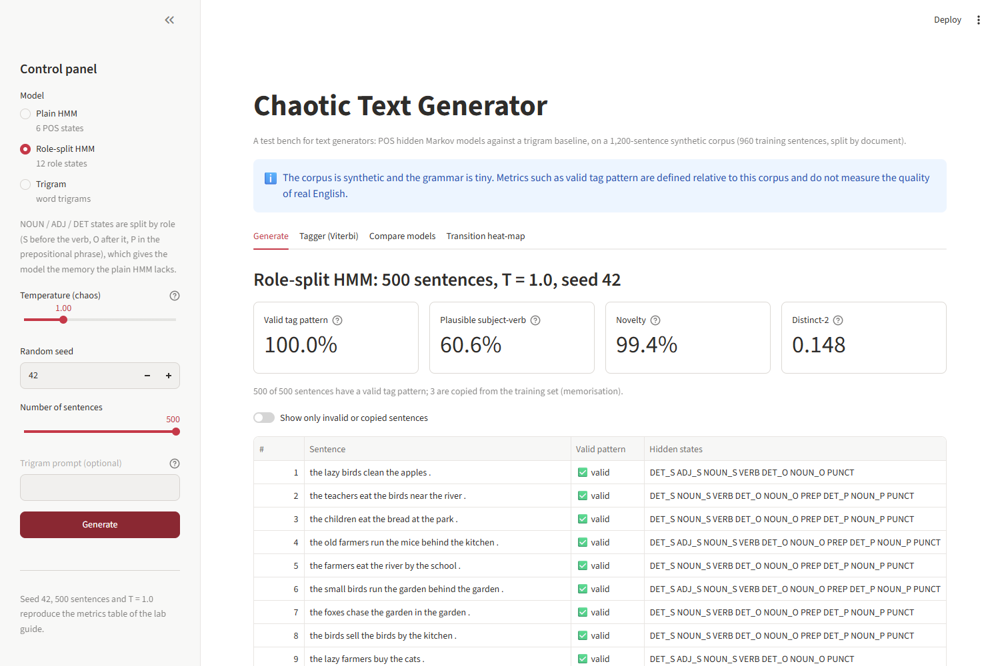
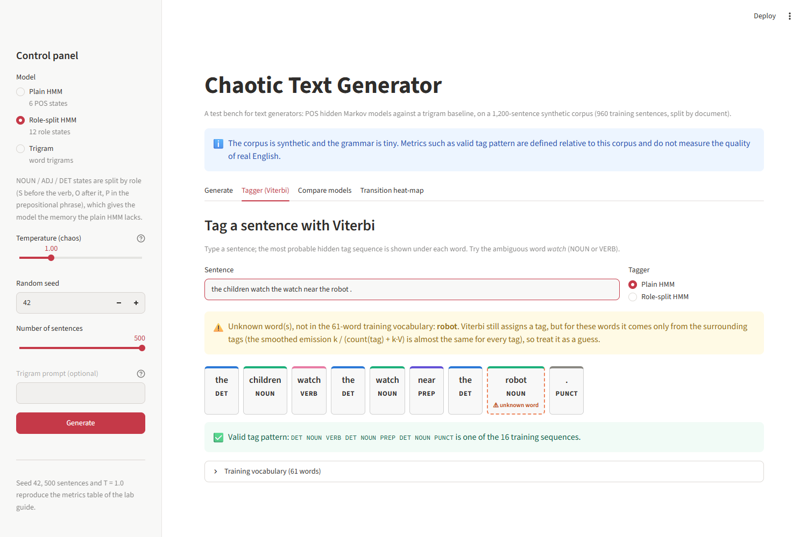

# Lab 03: Chaotic Text Generator

A **test bench for text generators**. It generates sentences with a part-of-speech Hidden Markov Model (HMM) or a trigram model, shows the hidden tag sequence behind each sentence, scores every batch with four metrics, and tags any sentence you type with the Viterbi algorithm.

**Live app:** https://mustapha005-lab-hmm.streamlit.app

| Generate (role-split HMM) | Viterbi tagger |
|---|---|
|  |  |

## What the app does

* **Control panel**: model (plain HMM, role-split HMM, trigram), temperature (0.3 to 3.0), random seed, number of sentences (10 to 500), optional trigram prompt.
* **Generate**: a table with one row per sentence showing the words, the hidden states / tag sequence, a valid-pattern mark and a memorisation flag (sentence copied from the training set).
* **Metrics panel**: valid tag pattern, plausible subject-verb, novelty, distinct-2.
* **Download CSV** of the generated batch.
* **Tagger**: Viterbi tag under each typed word. Unknown words get a visible warning and the app does not crash.
* **Compare models**: the three models at the same settings, and a plot of valid tag pattern against temperature.
* **Transition heat-map** of the plain and role-split HMMs.

Seed 42, 500 sentences and T = 1.0 reproduce the lab-guide table exactly:

| Model | Valid tag pattern | Plausible subject-verb | Novel | Distinct-2 |
|---|---|---|---|---|
| HMM, plain states | 16.2% | 14.8% | 99.8% | 0.198 |
| HMM, role-split states | 100% | 60.6% | 99.4% | 0.148 |
| Trigram | 57.0% | 76.0% | 91.2% | 0.105 |

## Run locally

```
pip install -r requirements.txt
streamlit run app.py
```

Evaluation scripts (run from this folder):

```
python -m src.evaluate          # synthetic corpus -> results/metrics.json, results/hmm_results.png, results/failures.txt
python -m src.evaluate_real     # real text (UD English EWT, downloaded on first run) -> results/ewt_results.json
```

## Deploy (Streamlit Community Cloud)

On https://share.streamlit.io: **Create app** → repository `mustapha005/LAB-HMM`, branch `main`, main file `app.py`. `requirements.txt` and `data/corpus.csv` are in the repository; `data/ewt/` (17 MB) is ignored and is not needed by the app.

## Files

| Path | Purpose |
|---|---|
| `app.py` | Streamlit test bench (the deliverable) |
| `src/pipeline.py` | HMM, Viterbi (log space), temperature sampling, role-split states, trigram generator, metrics |
| `src/evaluate.py` | Evaluation on the synthetic corpus (4 metrics, 4 temperatures, 500 sentences per setting) |
| `src/evaluate_real.py` | The same HMM and Viterbi on real text (Universal Dependencies English EWT) |
| `data/corpus.csv` | Synthetic tagged corpus (1,200 sentences, 6 tags); `data/make_data.py` regenerates it |
| `results/` | Outputs of the two evaluation scripts |
| `report/Lab03_Report.pdf` | One-page report (source: `report/report.html`) |
| `screenshots/` | Screenshots of the application |

## Data and limits

* `data/corpus.csv` is synthetic, generated by a small hand-written grammar (seed 42). Metrics such as valid tag pattern are defined relative to this corpus and do not measure the quality of real English.
* Universal Dependencies English EWT: licence CC BY-SA 4.0, https://github.com/UniversalDependencies/UD_English-EWT. On real text the same HMM reaches 88.0% tagging accuracy (most-frequent-tag baseline: 86.2%).
* Generated sentences are fluent but have no meaning or intent; do not present them as written by a person.
